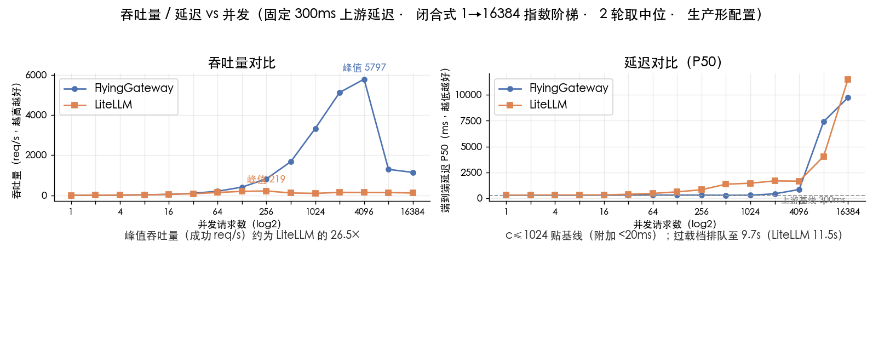

<div align="center">


# FlyingGateway

**智能体 LLM 网关** —— 多供应商端点注册、路由与降级、统一计量与治理。

</div>

## 一、项目概述

面向智能体（agent）的多供应商 LLM 网关：客户端用**一个 OpenAI 兼容入口**打任意注册模型，
网关负责把请求映射到对应供应商上游，并在转发链路上补齐网关该有的治理语义。

**设计要点**：

- **统一入口、注册表映射** —— `/v1/chat/completions`、`/v1/responses`、`/v1/messages`（Anthropic Messages）三入口同管线；
  用户面只认注册表里的模型别名，别名 → 上游模型 / 端点 / 协议形状的映射全在注册表，
  新增供应商只加注册表条目与适配器，不改调用方。
- **11 家供应商适配** —— OpenAI、Anthropic、Gemini、DeepSeek、Qwen、智谱、Kimi（moonshot）、
  MiniMax、MiMo（xiaomi）、Grok（xai）、Ollama；出站优先 OpenAI SDK Response API
  （Responses 形，Claude 走 Anthropic Messages、Gemini 走原生 SDK），
  usage 逐家归一到统一口径，费用按费率表计量。
- **路由与降级** —— `priority`（显式有序降级链）/ `round_robin` 两种策略；
  路由决策可复现（同输入 + 同注册表 + 同配置 ⇒ 同一决策），降级目标不可用时显式报错、
  不静默换端点。
- **治理语义** —— 错误九分类与可重试性、降级分账（⛔ 网关不重试，模型调用重试由 harness 系统控制）、
  端点熔断三态（连续失败熔断冷却、半开探测、熔断期间跳过转降级链）、token 级限流与预算、
  超时 / 取消 / 上游错误三分、流式逐帧转发与断连检测、显式取消（`/v1/cancel`）。
- **安全** —— 凭据只从环境变量读（注册表只存来源引用）、日志与轨迹统一脱敏
  （`[REDACTED:<类型>]`）、出网目标校验（默认禁内网，环回需显式放行）。

技术栈 **Go 1.27**，核心链路纯标准库（供应商 SDK 仅 3 个官方库）。

## 二、架构设计

一次调用的分层路径（自上而下；注册表是横切的唯一真源）：

```
客户端（OpenAI / Anthropic SDK、智能体 Harness）
  │  POST /v1/chat/completions · /v1/responses · /v1/messages
  ▼
┌ 入口层（server / codec）──────────────────────────────┐
│ 三形解码归一为统一契约 → 调用方鉴权（key_hash → scope）│
│ → 入站校验（模型别名 / 上下文估算 / 护栏 / 32MB 上限） │
│ → 鉴权与 scope 判定写审计（caller_decision 四元组）     │
├ 治理层（policy）─────────────────────────────────────┤
│ 配额与过载裁决：调用方桶 / 契约桶 / 并发位 / 过载闸     │
│ → 超限 429 + Retry-After（⛔ 网关不重试，调用方控制）  │
├ 路由层（registry / routing / breaker）────────────────┤
│ 注册表选端点（priority 降级链 / round_robin）          │
│ 熔断三态（连续失败冷却 → 半开探测 → 期间跳过转降级链） │
│ 七类失败类型 fallback_chains 分链降级                  │
├ 适配层（adapter / stream）───────────────────────────┤
│ 11 家供应商出站（Responses 形优先；Claude / Gemini 原生）│
│ 多 key 令牌池选键（per_key / shared / key_limits）     │
│ SSE 逐帧回传 + 断连检测 + 显式取消                     │
├ 归一与观测（usage / cost / errors / telemetry）────────┤
│ usage 逐家归一 → 费率表计费（预估扣减、收口结算）       │
│ 错误九分类 · 异步批量日志与 Prometheus 指标             │
└───────────────────────────────────────────────────────┘
```

**请求生命周期**（成功路径八步，错误锚点见 6.3）：

1. **解码归一** —— 三形入口解码为统一请求契约；入口协议与模型族绑定在此判定（违配 400 `ingress_protocol_mismatch`）。
2. **调用方鉴权** —— `callers` 非空时校验 key（401，三态同形防枚举）与 scope（模型集 / 端点集 / 预算，403 `scope_exceeded`），判定写审计。
3. **入站校验** —— 模型别名查注册表（404 `model_not_found`）、估算输入 + 输出上限对上下文窗口（400 `context_exceeded`）、护栏（403）、请求体 32 MB（413）。
4. **配额裁决** —— 按登记的契约桶（`tpm` / `rpm` / `burst_s`）、调用方桶、在途并发位与过载闸逐道判定；超限 429 + `Retry-After`；发起前按 `max_tokens` 预估扣减、收口按实际用量结算。
5. **路由与熔断** —— `strategy` 选端点；熔断命中时跳过冷却端点转降级链；七类失败类型各走自己的 fallback 链，降级目标不可用显式报错。
6. **出站适配** —— 按 `provider_name` 选适配器出站（同族协议零翻译）、多 key 池先探后扣选键、流式 SSE 逐帧回传。
7. **计量结算** —— usage 逐家归一（缓存相分列），费率表计费；预估扣减收口退还差额。
8. **收口观测** —— 错误九分类归一返回、断连检测收口、取消注册表兑现，日志与指标异步批量落出。

**关键机制**：

- **注册表唯一真源** —— 模型别名、端点、协议形状、配额、熔断参数全在 `-config` JSON；路由决策可复现（同输入 + 同注册表 ⇒ 同决策）。
- **两态热加载** —— `SIGHUP` / `POST /admin/reload` 先校验后原子替换：费率表与路由参数可热更；端点增删与运行时组件（`rate_limit` / `concurrency_limit` / `breaker` / `callers` …）显式拒绝、需重启（保护桶余额 / 冷却 / 熔断状态）。
- **两域解耦** —— 调用方令牌（管理本系统消费额度）与上游自有令牌互不相通，调用方凭据永不发给供应商。
- **多实例共享配额** —— `-redis-addr` 接 Redis 后限流 / 预算 / 上游 429 冷却跨实例一份（Lua 原子扣减）；Redis 故障 fail-open 放行 + 告警。
- **源码映射** —— 分层与包一一对应：入口 `server` + `codec`、治理 `policy`、路由 `registry` + `routing`、适配 `adapter` + `stream`、归一观测 `usage` + `cost` + `errors` + `telemetry`，横切安全在 `security`（出网校验 / 凭据 / 脱敏）。

## 三、功能总览

| 能力 | 要点 | 详见 |
|---|---|---|
| 三入口统一管线 | Chat / Responses / Anthropic Messages 同一转发管线，同族协议零翻译 | 6.1 |
| 11 家供应商适配 | 出站优先 Responses 形，Claude 走 Anthropic Messages、Gemini 走原生 SDK；usage 逐家归一 | 6.4 |
| 路由与降级 | `priority` 有序降级链 / `round_robin`，决策可复现，降级不可用显式报错 | 6.4 |
| 熔断三态 | 连续可归因失败阈值 → 冷却 → 半开探测；期间跳过转降级链 | 6.4 |
| 失败类型 fallback | 七类失败类型（`general` / `context_window` / `content_policy` / `budget` / `rate_limit` / `timeout` / `upstream_error`）各配降级链 | 6.4 |
| 多层限流 | 契约桶（端点 / 调用方 `tpm·rpm·burst_s`）+ 并发位 + 过载闸；未登记不限流、无默认值 | 6.4、6.5 |
| 多 key 令牌池 | 同供应商多 key 三层配额（`per_key` / `shared` / `key_limits`），N key = N 份容量 | 6.4 |
| 预算与护栏 | 调用方 token 预算（触顶 403 / 429）、正则 + Webhook 护栏 | 6.5、七 |
| 调用方鉴权与 scope | `key_hash` + 必填过期 + 模型 / 端点 / 预算 scope；审计四元组，明文与哈希不入日志 | 6.5 |
| 流式与断连检测 | SSE 逐帧转发、断连延迟上界检测、usage 末帧归一 | 6.2 |
| 显式取消 | `X-Client-Request-Id` + `/v1/cancel`，在途 409 语义、fire-and-forget | 6.1 |
| 错误九分类 | 归一 type + 具体 code；429 一律带 `Retry-After`；网关不重试 | 6.3 |
| 配置热加载 | 两态清单（可热更 / 需重启），先校验后原子替换 | 6.4 |
| 多实例部署 | Redis 跨实例共享配额；故障 fail-open + 告警 | 6.4 |
| 管理面与指标 | `/admin/*` + Prometheus `/metrics`（默认关闭，⛔ 不绑公网） | 6.4 |
| 费用计量 | 费率表驱动，预估扣减、收口结算 | 6.4 |
| 安全 | 凭据只存环境变量引用、日志轨迹统一脱敏、出网默认禁内网 | 一 |

## 四、目录结构

```
FlyingGateway/                  ← 仓库根
├── go.mod / go.sum             module github.com/zhaiwenjia/FlyingGateway（go 1.27）
├── .env / .env.example         运行配置（真值只存 .env，⛔ 不入库）
├── AGENTS.md                   ★ 协作规则的唯一来源
├── README.md
├── LICENSE
├── images/                     logo 等静态资源
├── cmd/
│   └── gateway/                程序入口（flag 解析、装配、启动）
├── internal/
│   ├── server/                 HTTP 服务：三入口管线、调用方鉴权、取消注册表、管理面
│   ├── core/                   核心契约（请求/响应/流帧/Provider 枚举）
│   ├── codec/                  入站编解码（Chat / Responses / Messages 三形）
│   ├── stream/                 流式转发、SSE 扫描与帧编码
│   ├── adapter/                11 家供应商适配器（出站协议转换、usage 归一）
│   ├── registry/               端点注册表（路由的唯一真源）
│   ├── routing/                路由与降级链
│   ├── detect/                 断连检测
│   ├── policy/                 限流与预算（令牌桶、token 预算）
│   ├── security/               出网校验、凭据脱敏
│   ├── usage/                  用量归一
│   ├── cost/                   费用计量（费率表驱动）
│   ├── errors/                 错误九分类
│   ├── telemetry/              日志与指标（异步批量）
│   └── version/                版本载体（-ldflags 注入点）
├── config/
│   ├── gateway.example.json    端点注册表样例
│   ├── gateway.json            端点注册表（正式配置，7 端点）
│   └── rates.json              费率表（费用计量数据源）
```

## 五、快速开始

需 Go 1.27+（[go.dev](https://go.dev/dl/)）。

**1. 构建**

```bash
go build -o bin/gateway ./cmd/gateway
```

**2. 配环境变量**（凭据只从环境变量读，⛔ 不入库、不进命令行明文）

| 变量                    | 用途                                                                                                                                      |
| ----------------------- | ----------------------------------------------------------------------------------------------------------------------------------------- |
| `<credential_ref>`    | 上游凭据。注册表每条 endpoint 的 `credential_ref` 写**环境变量名**（如 `OPENAI_API_KEY`、`DEEPSEEK_API_KEY`），真值由环境注入 |
| `GATEWAY_ADMIN_TOKEN` | 管理面鉴权 token（仅开管理面时需要）                                                                                                      |
| `GATEWAY_REDIS_PASSWORD` | Redis 密码（仅 `-redis-addr` 多实例模式时需要）                                                                                       |

**3. 配置文件**

- `config/gateway.example.json` —— 端点注册表（字段说明见「六、出入口使用 / 出口」）；
- `config/rates.json` —— 费率表（每模型各类 token 的绝对单价，费用计量数据源）。

**4. 开启服务**

```bash
./bin/gateway -config config/gateway.example.json -rates config/rates.json -listen 127.0.0.1:8080
# 或免构建直接跑：
go run ./cmd/gateway -config config/gateway.example.json -rates config/rates.json -listen 127.0.0.1:8080
```

三个路径参数都有默认值（`config/gateway.example.json` / `config/rates.json` / `:8080`），
在仓库根目录下 `./bin/gateway` 一条命令即可起；启动日志走 stderr，`{"status":"ok"}` 出现即就绪。
⚠️ `-listen` 默认 `:8080` 是**全接口**监听，对外部署时显式给内网 IP（如示例的 `127.0.0.1:8080`）。

可选开关（全表见「七、运行参数」）：

- **管理面**（默认关闭）：`-admin-listen 127.0.0.1:8090` + 环境变量 `GATEWAY_ADMIN_TOKEN`
  （缺 token 拒启），提供 `/admin/*` 与 `/metrics`；监听地址须 IP 字面量（环回 / 私网），⛔ 不绑公网；
- **本地环回上游**（Ollama 等）：加 `-allow-loopback`；
- **多实例共享配额**：`-redis-addr host:port`（密码走 `GATEWAY_REDIS_PASSWORD`）。

**5. 验证**

```bash
curl http://127.0.0.1:8080/health
# {"status":"ok"}
curl http://127.0.0.1:8080/health/readiness
# {"status":"ready"}
```

**6. 停止与热加载**

- 停止：`Ctrl+C`（SIGINT）或 SIGTERM ⇒ 在途请求以 `shutdown` 原因收口后优雅退出；
- 热加载：`SIGHUP` 或管理面 `POST /admin/reload` 重读注册表 / 费率表（先校验后原子替换，
  失败保留旧表；端点增删等需重启项会显式拒绝，见 6.4）。

## 六、出入口使用

入口是**调用面**（客户端怎么调），出口是**运维面**（上游怎么配）。调用顺序看 6.1 → 6.2 → 6.3；部署配置看 6.4。

### 6.1 入口（客户端 → 网关）

OpenAI 兼容 HTTP API。注册表 `callers` 非空时，`/v1/*` 须带
`Authorization: Bearer <key>`（缺失 / 无效 / 过期 ⇒ 401 通用错误，三态不区分防枚举；
超 scope ⇒ 403 `scope_exceeded`）。调用方登记与密钥生命周期见 6.5。

**入口协议与模型族绑定（强制）**：Claude 模型（`provider_name: "anthropic"`）**只走**
`/v1/messages`（Anthropic 形，由始至终 Anthropic SDK）；其它供应商模型**只走**
`/v1/chat/completions` / `/v1/responses`（OpenAI 形）。违配 ⇒ `400 ingress_protocol_mismatch`，
⛔ 不静默跨形状翻译 —— 同族全程协议零翻译（thinking / 签名 / 缓存控制保真）。

| 方法与路径                    | 说明                                                                      |
| ----------------------------- | ------------------------------------------------------------------------- |
| `POST /v1/chat/completions` | Chat Completions 兼容（流式 / 非流式）。`model` 填注册表的模型别名      |
| `POST /v1/responses`        | OpenAI Responses 兼容入口（同一转发管线）                                 |
| `POST /v1/messages`        | Anthropic Messages 兼容入口（Anthropic SDK / Claude Code 类客户端可直连；同一转发管线） |
| `GET /v1/models`            | 列出注册表模型别名与能力（tools / stream / vision、上下文窗口、输出上限） |
| `POST /v1/cancel`           | 显式取消在途执行，请求体 `{"client_request_id": "..."}`                 |
| `GET /health`               | 存活探针（不鉴权）                                                        |
| `GET /health/readiness`     | 就绪探针（不鉴权）：就绪 200 / 优雅关闭中 503                              |

**非流式调用**：

```bash
curl http://127.0.0.1:8080/v1/chat/completions \
  -H "Authorization: Bearer $GATEWAY_CALLER_KEY" \
  -H "Content-Type: application/json" \
  -d '{"model": "gpt-6-luna", "messages": [{"role": "user", "content": "你好"}], "stream": false}'
```

**流式调用**（`"stream": true`，收 SSE 帧；末帧带 usage 归一后计量）：

```bash
curl -N http://127.0.0.1:8080/v1/chat/completions \
  -H "Authorization: Bearer $GATEWAY_CALLER_KEY" \
  -H "Content-Type: application/json" \
  -d '{"model": "gpt-6-luna", "messages": [{"role": "user", "content": "你好"}], "stream": true}'
```

**请求标识与取消**：可选请求头 `X-Client-Request-Id` 携带本轮唯一标识（不传则网关生成），
后续用它取消：`POST /v1/cancel` 传 `{"client_request_id": "..."}`，返回 `{"cancelled": true|false}`
（fire-and-forget：查不到 / 已收口静默忽略）。同 id 已有执行在途 ⇒ 409 `request_in_flight`；
该 id 已进取消终态 ⇒ 409 `request_cancelled`。

**请求上限**：请求体 32 MB（超出 413 `request_too_large`）。
出错时的错误对象形状与全部错误码见 6.3。

### 6.2 请求 / 响应 Schema（输入 / 输出）

**通用 HTTP 头**（两个入口一致）：

| 头 | 说明 |
|---|---|
| `Authorization: Bearer <key>` | 调用方 key（注册表 `callers` 非空时必带；只做调用方鉴权，⛔ 永不发给上游） |
| `Content-Type: application/json` | 请求体为 JSON |
| `X-Client-Request-Id` | 可选。本轮唯一标识，供 `/v1/cancel` 与请求合并；不传则网关生成 |

**输入 · `POST /v1/chat/completions`**：

| 字段 | 类型 | 必填 | 说明 |
|---|---|---|---|
| `model` | string | ✅ | 注册表模型别名（列表外 ⇒ 404 `model_not_found`） |
| `messages` | array | ✅ | 消息数组（见下） |
| `stream` | bool | — | `true` = SSE 流式 |
| `temperature` / `top_p` | number | — | 采样参数 |
| `stop` | string 或 [string] | — | 停止序列 |
| `max_tokens` / `max_completion_tokens` | int | — | 输出上限（参与上下文越界估算与预估扣减） |
| `tools` | array | — | `[{type:"function", function:{name, description, parameters}}]` |
| `tool_choice` | string 或 object | — | `auto` / `none` / `required` / 指定函数 |
| `reasoning_effort` | string | — | 推理强度（透传给支持的上游） |

`messages[]` 元素：`role`（`system` / `user` / `assistant` / `tool`）、`content`（string 或
part 数组：`{type:"text", text}` / `{type:"image_url", image_url:{url}}`）、
`reasoning_content`（多轮带思考回填）、`tool_calls[]`（`{id, type, function:{name, arguments}}`）、
`tool_call_id`（tool 角色回填）、`name`。

**输入 · `POST /v1/responses`**：

| 字段 | 类型 | 必填 | 说明 |
|---|---|---|---|
| `model` | string | ✅ | 注册表模型别名 |
| `input` | string 或 array | ✅ | 文本或 item 数组（`message` / `reasoning` / `function_call` / `function_call_output` …） |
| `instructions` | string | — | 系统指令 |
| `tools` / `tool_choice` | array / string·object | — | 同 Chat 语义 |
| `max_output_tokens` | int | — | 输出上限 |
| `temperature` / `top_p` | number | — | 采样参数 |
| `stream` | bool | — | `true` = 事件流 |
| `previous_response_id` | string | — | 前轮响应续接（端点不支持时 ⇒ 400 `unsupported_capability`） |
| `conversation` | string 或 {id} | — | 会话引用 |
| `prompt_cache_key` | string | — | 缓存亲和键 |
| `reasoning` | object | — | `{effort, summary, context, mode}` |

**输出 · 非流式（Chat，`object:"chat.completion"`）**：

```json
{
  "id": "chatcmpl-xxx",
  "object": "chat.completion",
  "created": 1731560000,
  "model": "gpt-6-luna",
  "choices": [{
    "index": 0,
    "message": {
      "role": "assistant",
      "content": "你好",
      "reasoning_content": "（思考过程，可选）",
      "tool_calls": [{"id": "call_x", "type": "function",
                       "function": {"name": "f", "arguments": "{}"}}]
    },
    "finish_reason": "stop"
  }],
  "usage": {
    "prompt_tokens": 9, "completion_tokens": 3, "total_tokens": 12,
    "prompt_tokens_details": {"cached_tokens": 0, "cache_write_tokens": 0},
    "completion_tokens_details": {"reasoning_tokens": 0}
  },
  "x_gateway": {"degradations": [{"field": "...", "reason": "...", "detail": "..."}]}
}
```

`finish_reason` 取值：`stop` / `length` / `tool_calls` / `content_filter` / `function_call`。
`x_gateway.degradations[]` 是跨供应商映射的**不可逆语义丢失标记**（`field` / `reason` / `detail`），
无丢失则不出现。

**输出 · 流式（Chat，`stream:true`）**：SSE 帧序列，每帧一条 `data: {chat.completion.chunk}`
（`choices[].delta` 增量：`content` / `reasoning_content` / `tool_calls[]`，`tool_calls[]` 带
`index`/`id`/`function{name,arguments}` 增量）；末帧带 `finish_reason` 与归一 `usage`，
以 `data: [DONE]` 收尾。

**输出 · Responses（`object:"response"`）**：

```json
{
  "id": "resp_xxx",
  "object": "response",
  "created_at": 1731560000,
  "status": "completed",
  "model": "gpt-6-luna",
  "output": [{"type": "message", "role": "assistant", "content": [{"type": "output_text", "text": "你好"}]}],
  "output_text": "你好",
  "usage": {
    "input_tokens": 9, "output_tokens": 3, "total_tokens": 12,
    "input_tokens_details": {"cached_tokens": 0, "cache_write_tokens": 0},
    "output_tokens_details": {"reasoning_tokens": 0}
  },
  "incomplete_details": {"reason": "max_output_tokens"},
  "x_gateway": {"degradations": []}
}
```

`status` 六值原值透传：`completed` / `failed` / `in_progress` / `cancelled` / `queued` /
`incomplete`（Responses 体系用 `status`，不用 `finish_reason`）；`incomplete_details.reason`：
`max_output_tokens` / `max_messages` / `content_filter` / `steered`。流式为 `event: response.*` +
`data:` 双字段事件流（`response.output_text.delta` / `response.reasoning_text.delta` /
`response.function_call_arguments.delta` / 终止事件等）。

**输出 · usage 归一口径**（两入口一致语义）：`input`/`prompt` 侧为**总输入**（缓存命中与缓存写入
分列在 `*_tokens_details`，不打折并入）；`output`/`completion` 侧含 `reasoning_tokens` 维度。
所有 usage 经逐家归一（MiMo 两拍收口、Kimi `choices[0].usage` 等差异在适配层抹平）。

**输入 / 输出 · `POST /v1/messages`（Anthropic Messages）**：

输入（`application/json`）：`model` 与 `max_tokens` 必填；`messages[]` 的 `content` 为 string 或
块数组（`text` / `image{source:{type:"base64"|"url", …}}` / `tool_use` / `tool_result` /
`thinking{thinking, signature}` / `redacted_thinking`）；`system` 为 string 或 text 块数组；
`tools[]` 用 `input_schema`（JSON Schema）；`tool_choice` 为 `{type: auto|any|tool|none, name?}`；
采样与生成控制 `temperature` / `top_p` / `top_k` / `stop_sequences` / `stream` /
`thinking{type, budget_tokens}`；`metadata` 接受但网关不消费。⚠️ 当前仅支持**单个**
`cache_control` 断点（多断点显式报错，⛔ 不静默取一）。

输出（非流式）为 Messages 响应体：`{id, type:"message", role:"assistant", model,
content:[text|thinking|redacted_thinking|tool_use 块], stop_reason, stop_sequence, usage}`。
`stop_reason` 取值：`end_turn` / `max_tokens` / `tool_use` / `stop_sequence` / `refusal`
（Chat 家族值自动翻译：`stop`→`end_turn`、`length`→`max_tokens` 等）；`usage` 为 Anthropic
三项口径（`input_tokens` 为**未缓存**输入，`cache_creation_input_tokens` /
`cache_read_input_tokens` 分列缓存相）。流式为 Anthropic 事件流：`message_start` →
`content_block_start` / `content_block_delta`（`text_delta` / `thinking_delta` /
`signature_delta` / `input_json_delta`）/ `content_block_stop` → `message_delta`（stop_reason +
usage）→ `message_stop`。

**辅助端点**：

| 端点 | 输入 | 输出 |
|---|---|---|
| `GET /v1/models` | — | `{"object":"list","data":[{id, object:"model", owned_by, context_window, max_output_tokens, capabilities:{supports_tools, supports_stream, supports_vision}}]}` |
| `POST /v1/cancel` | `{"client_request_id": "..."}` | `{"cancelled": true\|false}` |
| `GET /health` | — | `{"status":"ok"}` |

### 6.3 错误代码列表

错误对象为 OpenAI 风格 `{"error": {"type", "code", "message"}}`：`type` 是归一化分类（九类），
`code` 是具体错误码；429 一律带 `Retry-After`；上游错误对内保留原始上游状态码与请求 ID。

**分类 → HTTP 状态**：

| 分类（type） | HTTP | 含义 |
|---|---|---|
| `invalid_request` | 400 | 请求不合法（解析失败 / 参数非法 / 能力不匹配） |
| `context_exceeded` | 400 | 估算输入 + 输出上限超出注册表上下文窗口 |
| `content_policy` | 403 | 护栏命中（正则 / Webhook） |
| `auth` | 401 | 鉴权失败 |
| `rate_limit` | 429 | 限流（各闸，带 `Retry-After`） |
| `budget_exceeded` | 429 | 预算触顶（发起上游前拒绝） |
| `timeout` | 504 | 上游超时 |
| `cancelled` | 499 | 执行取消（客户端断连 / 显式取消 / 进程关闭） |
| `upstream_error` | 502 | 上游失败 |

**具体错误码**：

| HTTP | code | 触发场景 |
|---|---|---|
| 400 | `invalid_request` | 请求体解析失败 / 字段非法 |
| 400 | `context_exceeded` | 估算输入 + 输出上限超出 `context_window` |
| 400 | `unsupported_capability` | 请求能力超出端点能力（如不支持的 `previous_response_id`） |
| 400 | `detect_failed` | 端点供应商识别失败（`base_url` / `upstream_model` 推断不出供应商） |
| 400 | `ingress_protocol_mismatch` | 入口协议与模型族错配（Claude 模型须走 `/v1/messages`，其它供应商须走 OpenAI 形入口） |
| 400 | `invalid_content_part` / `invalid_tool_arguments` / `invalid_tool_schema` | 请求内容或工具定义不合法 |
| 401 | `unauthorized` | 调用方 API key 缺失 / 无效 / 过期（注册表 `callers` 非空时；三态同形防枚举，归因见审计） |
| 403 | `scope_exceeded` | 超调用方 scope（模型集 / 端点集 / token 预算，见 6.5） |
| 403 | `content_policy` | 护栏命中 |
| 403 | `egress_denied` | 出网目标被拒（内网地址；本地环回需 `-allow-loopback`） |
| 404 | `model_not_found` | 模型名不在注册表（⛔ 不透传任意模型名） |
| 409 | `request_in_flight` | 同 `client_request_id` 已有执行在途 |
| 409 | `request_cancelled` | 该 id 已进取消终态 |
| 413 | `request_too_large` | 请求体超 32 MB |
| 429 | `rate_limit` | 限流超限（全局桶 / 调用方桶 / 契约桶 / 并发位 / 端点配额），带 `Retry-After` |
| 429 | `token_pool_exhausted` | 全部自有令牌受限（`Retry-After` = 最短等待） |
| 429 | `overloaded` | 过载闸满（`--max-in-flight`），带 `Retry-After` |
| 429 | `budget_exceeded` | 预算触顶 |
| 499 | `cancelled` | 执行取消收口 |
| 500 | `internal` | 网关内部错误 |
| 500 | `credential_unresolved` | `credential_ref` 环境变量解析失败 |
| 500 | `auth_scheme_missing` | 适配器未声明鉴权头 |
| 502 | `upstream_error` | 上游 5xx / 错误体 / 响应解析失败（对内诊断子码：`response_parse_failed`、`encode_failed`、`stream_encode_failed`、`stream_finish_failed`、`request_build_failed`、`request_marshal_failed` 等） |
| 502 | `endpoint_cooling` | 端点熔断冷却中被跳过（降级链上无可用端点时的最终报错；状态见 `/admin/health`） |
| 504 | `timeout` | 单次上游调用超时（端点 `timeout_s` 预算） |

**可重试性**：网关 ⛔ 不做模型调用重试 —— 重试由 harness / 调用方系统控制，失败原样返回
（上游 HTTP 状态码透传、`429` 一律带 `Retry-After` 供调用方尊重等待）。对调用方而言
`429` / `502` / `504` 可重试；`499` 取消后抑制令牌轮换与降级（⛔ 不再打上游）；
其余 4xx 为请求问题，不值得重试。

### 6.4 出口（网关 → 上游）

出口由**端点注册表**（`-config` 指定的 JSON）描述，`strategy` 定路由策略，
`endpoints[]` 每条登记一个上游端点：

| 字段                  | 含义                                                                                                                                                                      |
| --------------------- | ------------------------------------------------------------------------------------------------------------------------------------------------------------------------- |
| `name`              | 端点名（日志 / 指标用）                                                                                                                                                   |
| `base_url`          | 上游地址（含 `/v1`）                                                                                                                                                    |
| `model`             | **用户面模型别名**（客户端 `model` 字段填它）                                                                                                                     |
| `upstream_model`    | 上游真实模型名（网关出站时替换）                                                                                                                                          |
| `provider_name`     | 适配器：`openai` / `anthropic` / `gemini` / `deepseek` / `qwen` / `zhipu` / `moonshot` / `minimax` / `xai` / `xiaomi` / `ollama`                    |
| `context_window`    | 上下文窗口（token）                                                                                                                                                       |
| `max_output_tokens` | 输出上限（token）                                                                                                                                                         |
| `capabilities`      | 能力标记：`supports_tools` / `supports_stream` / `supports_vision`                                                                                                  |
| `credential_ref`    | **凭据来源引用**（环境变量名，⛔ 不是凭据本身）                                                                                                                     |
| `timeout_s`         | 单次上游调用超时（秒）                                                                                                                                                    |
| `priority`          | 降级优先级（`strategy=priority` 时数值小者先）                                                                                                                          |
| `rate_limit`        | 可选，套餐契约配额 `{tpm, rpm, burst_s}`（tokens/min、requests/min、桶深折算秒数）；**未登记 ⇒ 不限流**，⛔ 无默认值                                             |
| `concurrency_limit` | 可选，在途上游请求数上限（0 = 不限）；并发按**在途上游尝试**计（发起 +1 / 收口 −1，流式占位到流收口）                                                              |
| `limits_group`      | 可选，配额共享组名：同组端点共享一份 `rate_limit` / `concurrency_limit` 计数（同供应商多模型 / 多 key / 多部署共享配额池的语义）；空 = 自成一组，同组声明必须逐字一致 |
| `breaker`           | 可选，端点熔断三态配置 `{failure_threshold, cooldown_s, probe}`（连续可归因失败阈值 / 冷却秒数 / 半开同时放行探测数）；缺省 = `5 / 30 / 1` |

- **路由语义**：`priority` = 显式有序降级链（主端点失败沿链回退，降级目标须可用，
  不可用显式报错）；`round_robin` = 轮转。路由决策可复现，顺序不依赖遍历偶然性。
- **配额与过载（锚点分离）**：限流锚定套餐契约（端点 `rate_limit` / 调用方 `callers.rate_limit`
  按登记走，未登记 ⇒ 不限流），过载保护锚定实测容量（`--max-in-flight`）；
  两道闸并联判定，超限一律 `429` + `Retry-After`。多供应商混合流量下，每次上游尝试
  占它命中端点（或其共享组）的并发位与配额 —— 降级换供应商即换计数主体。
- **上游多 key（`credential_rate_limits`）**：同一供应商多个 key（`credential_ref` 环境变量值
  逗号/换行分隔）可按三层登记套餐配额 —— `per_key` 每 key 一份桶（N key = N 份容量）、
  `shared` 全池共享（org/项目级配额池）、`key_limits` 逐 key 覆盖（不同订阅档混池）；
  未登记不限流。**核算**：聚合稳态 = min(Σ 各 key 配额, shared)——10 个同规格 key = 10 份
  套餐容量，共享桶封顶取 min；选键先探后扣、桶空溢出下一槽，429 只冷却命中的 key；
  每 key 桶余量可查管理面 `GET /admin/credential-pools`。
  ⚠️ **两域解耦**：调用方令牌（外部项目签发，只管理本系统的消费额度）与上游自有令牌
  互不相通，⛔ 调用方凭据永不发给供应商。
- **出站协议**：优先 Responses 形（`POST {base}/responses`；Claude 走 Anthropic Messages、
  Gemini 走原生 SDK），流式经 SSE 逐帧转发（`response.completed` 等终态事件收口）；
  usage 逐家归一后计量费用（费率表）。
- **出网校验**：默认拒绝内网目标地址；本地 Ollama 等环回上游用 `-allow-loopback` 放行。
- **管理面**（默认关闭）：`-admin-listen <内网地址>` + `GATEWAY_ADMIN_TOKEN` 开启后提供
  `GET /admin/endpoints`（注册表全量视图，只含凭据来源引用，可安全输出）、
  `GET /admin/health`（含端点熔断状态 `breakers` 与巡检 `probes`）、`GET /admin/credential-pools`、
  `GET /metrics`（Prometheus 文本暴露格式 0.0.4：请求/取消/token 计数、断连检测
  延迟直方图、usage 缺失率、熔断状态 gauge）与 `POST /admin/reload`（配置热加载）。
  ⛔ 管理面不绑公网。
- **配置热加载**：`SIGHUP` 或 `POST /admin/reload` 重读注册表/费率表，先校验后原子替换、
  失败保留旧表。可热更：费率表、端点 `base_url`/`upstream_model`/`timeout_s`/
  `priority`/`context_window`/`max_output_tokens`/`capabilities`/`fallback_chains`；
  **需重启**（显式拒绝并列出）：端点增删、`rate_limit`/`concurrency_limit`/`limits_group`/
  `breaker`/`credential_rate_limits`/`callers`（运行时组件绑定，热换会洗掉
  桶余额/冷却/熔断状态）。
- **多实例部署**：`-redis-addr` 接 Redis 后限流/预算/上游 429 冷却计数**跨实例一份配额**
  （Lua 原子扣减 + `TIME` 统一时钟；不设 = 内存单实例模式）；Redis 故障时限流/预算
  fail-open 放行 + warn 告警（业务可用性优先，恢复自动回归）。

### 6.5 调用方校验（注册表 `callers`）

调用方的**身份 + 密钥 + 过期 + scope + 配额**在注册表 `callers` 节合一登记（单源）。
`callers` 为空 ⇒ 开放模式（不校验，本地形态）；非空 ⇒ `/v1/*` 强制鉴权。

```json
"callers": [
  {
    "name": "frontend",
    "keys": [
      { "key_hash": "<sha256 小写 hex 64 位>", "expires_at": "2027-02-18T00:00:00Z" }
    ],
    "scope": {
      "models": ["gpt-6-luna", "gpt-4o"],
      "endpoints": ["primary", "backup"],
      "token_budget": 0
    },
    "rate_limit": { "tpm": 600000, "rpm": 600, "burst_s": 10 }
  }
]
```

| 字段 | 含义 |
|---|---|
| `name` | 调用方标识（审计 / 预算 / 限流按它归并；全局唯一） |
| `keys[]` | 密钥登记 1–2 把：`key_hash` = key 的 **SHA-256 小写 hex**（⛔ 明文不入配置，非此形状启动报错）；`expires_at` = 过期时刻（RFC3339，必填、必须未来，⛔ 永不过期） |
| `scope.models` | 允许的模型集（显式非空，须引用已登记模型；⛔ 不设默认全集） |
| `scope.endpoints` | 允许的端点集（显式非空；降级链同样受此约束，⛔ 降级不绕过 scope） |
| `scope.token_budget` | token 预算上限（0 = 不限）；触顶 ⇒ 403 `scope_exceeded` |
| `rate_limit` | 可选，契约配额 `{tpm, rpm, burst_s}`；**未登记 ⇒ 不限流**，⛔ 不套默认值 |

**密钥签发与轮换**：
1. 生成 key（≥ 128 bit 熵）：`openssl rand -hex 32`；
2. 只把哈希入配置：`printf '%s' '<key>' | shasum -a 256`（或 `openssl dgst -sha256`），
   明文 key 通过安全信道交给调用方，⛔ 不落配置 / 日志 / 命令行；
3. 轮换 = 新旧两把 key 并存（`keys` 放 2 条）→ 调用方切新 key → 旧 key 到期自动失效
   或从配置移除（轮换窗口不断流，⛔ 不堆历史 key）；
4. 过期：运行期到 `expires_at` 立即拒（401）；配置里留着过期 key 会在下次启动时报错。

**判定与留痕**：鉴权（401）与 scope（403）判定都写审计行（结构化日志
`caller_decision`）：`caller` / `route` / `decision` / `correlation_id` 四元组 + `reason`，
⛔ 明文 key 与哈希都不入日志。入口剥离外部身份类 header（`X-User-Id` / `X-Org-Id` /
`X-Role` / `X-Tenant-Id` / `X-Forwarded-User`，⛔ 公网 header 直通），身份一律以 key
鉴权结果为准（网关自设）。

## 七、运行参数

长选项与单字母缩写双形式等价（如 `--config` / `-c`）。

| 参数                           | 短     | 说明                                                                            | 默认                            |
| ------------------------------ | ------ | ------------------------------------------------------------------------------- | ------------------------------- |
| `--config`                   | `-c` | 端点注册表配置路径（JSON）                                                      | `config/gateway.example.json` |
| `--rates`                    | `-r` | 费率表路径（JSON）                                                              | `config/rates.json`           |
| `--listen`                   | `-l` | 数据面监听地址（host:port）                                                     | `:8080`（全接口）             |
| `--admin-listen`             | `-a` | 管理面监听地址（须内网 IP，⛔ 不绑公网）                                        | 关闭                            |
| `--allow-loopback`           | `-L` | 出网校验放行环回地址（本地 Ollama 等）                                          | 关                              |
| `--pprof-listen`             | `-p` | pprof 排障端点（只绑环回，⛔ 不绑公网）                                         | 关闭                            |
| `--cancel-grace`             | `-g` | 延迟取消窗口（0 = 立即取消）                                                    | `0`                           |
| `--cancel-grace-provider`    | `-G` | 按 provider 覆盖延迟窗口（`provider=时长`，可重复）                           | —                              |
| `--detect-bound`             | `-d` | 断连检测延迟上界                                                                | `1s`                          |
| `--rate-capacity`            | `-C` | token 限流桶容量（0 = 不限流）                                                  | `0`                           |
| `--rate-refill`              | `-R` | token 限流补充速率（token/秒）                                                  | `0`                           |
| `--budget-tokens`            | `-B` | 每调用方 token 预算上限（0 = 不限）                                             | `0`                           |
| `--upstream-bucket-capacity` | `-U` | 每自有令牌的本地令牌桶容量（契约配额走注册表 `rate_limit`；0 = 关闭）         | `0`                           |
| `--upstream-bucket-refill`   | `-u` | 每自有令牌的本地令牌桶补充速率（token/秒）                                      | `0`                           |
| `--rate-limit-cooldown`      | `-k` | 上游 429 无 Retry-After 时的令牌默认冷却                                        | `30s`                         |
| `--max-token-wait`           | `-m` | 全部令牌受限时的最长等待（超上限 ⇒ 429 + Retry-After）                         | `3s`                          |
| `--max-in-flight`            | `-i` | 过载保护：在途请求数上限（0 = 不限；按实测容量标定，超限 ⇒ 429 + Retry-After） | `0`                           |
| `--upstream-probe-interval`  | `-I` | 上游周期巡检间隔（HTTP 可达性巡检、⛔ 不发模型调用；0 = 不启用）              | `0`                           |
| `--upstream-probe-timeout`   | `-T` | 单次上游巡检探测超时                                                          | `3s`                          |
| `--redis-addr`               | `-A` | Redis 地址（空 = 内存单实例模式）：限流/预算/冷却计数跨实例共享；密码走 `GATEWAY_REDIS_PASSWORD` | —                             |
| `--guardrail-pattern`        | `-P` | 护栏正则（可重复）                                                              | —                              |
| `--guardrail-webhook`        | `-W` | 护栏 Webhook URL（空 = 只做正则）                                               | —                              |
| `--version`                  | `-V`  | 打印版本号后退出                                                                | —                              |

## 八、与 LiteLLM 的性能对比

受控基准（固定 300ms 上游延迟，闭合式 1→16384 并发指数阶梯，2 轮取中位；两侧同假上游同压测器；
生产形配置 = 契约桶开 + 并发闸 16000 + 过载闸 16500）：



| 指标                               | FlyingGateway                             | LiteLLM               |
| ---------------------------------- | ----------------------------------------- | --------------------- |
| 峰值吞吐量（成功 req/s，2 轮中位） | **5797**（c=4096）                  | 219（c=256）          |
| 端到端延迟 P50，c≤1024            | **301–316ms**（贴 300ms 上游基线） | 325ms 起爬升至 1.5s   |
| 最大并发容量（成功在途）           | **~16.5k**（超限 502 优雅拒绝）     | ~2k（超限断连丢请求） |
| 单连接内存（RSS/连接）             | **~146KB**                          | ~450KB                |


- 过载语义：FlyingGateway 超限返回 502 优雅拒绝、恢复 P50 1.5ms；LiteLLM 断连丢弃在途请求、恢复 267ms→4.9s。
- 口径注记：吞吐为**成功口径**；顶档（c≥8192）轮间方差大（一轮出 502 浪潮、一轮排队无失败），图为 2 轮中位。
- 单源 IP 出站本地端口 bind 排他（16384 端口池）是超高并发的硬上限；部署建议：多源 IP / 多实例横向扩出站。

## 九、测试与版本

```bash
gofmt -l .            # 格式门禁（有输出即失败）
go vet ./...          # 静态检查
go test -race ./...   # 全量测试（含竞态检测）
```

当前版本 **0.15.0**（git tag `v0.15.0`）。版本 = **git tag**（`v主.大.小`），⛔ 不在源码硬编码版本常量；需要运行时版本的构建用
`-ldflags` 注入 `internal/version` 的 `Version` 变量。协作规则见 [`AGENTS.md`](AGENTS.md)。

## 试用与反馈

测试是不完整的，这点说在前面：适配了 11 家供应商，其中 8 家打过真实调用
（OpenAI、DeepSeek、Kimi、Qwen、智谱、MiMo、MiniMax、Ollama；Responses 形四项电池
basic / tools / reasoning / stream，真实响应样本 30 份入 `internal/adapter/testdata/real/`），
其余 3 家（Grok、Gemini、Claude）只过了单元测试与文档口径核对；
所有功能测试与压测都在单机上跑，真实网络下的表现会有出入，没覆盖到的组合还有很多。

欢迎试用。遇到问题、发现 bug、或者对设计有不同看法，[提 issue](https://github.com/zhaiwenjia/FlyingGateway/issues) 就好。
