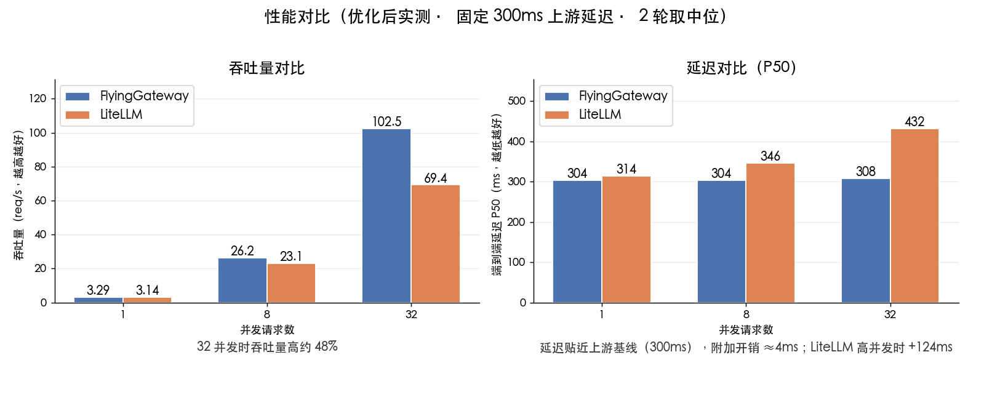
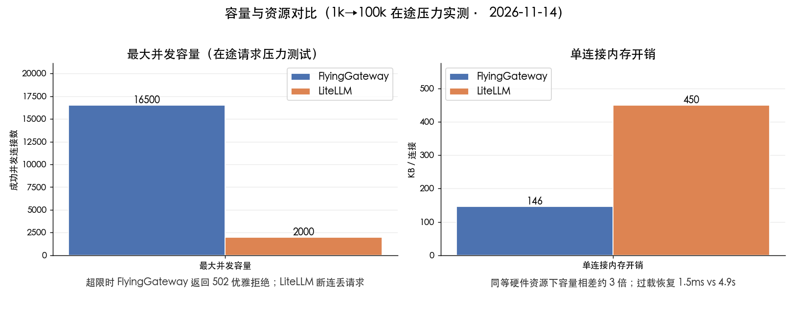

<div align="center">


# FlyingGateway

**智能体 LLM 网关** —— 多模型端点注册、请求路由与分发、失败重试与降级。

</div>

## 一、项目概述

面向智能体（agent）的 LLM 网关。一个 agent 的请求往往要打到**不同模型**上
（快的打热路径、强的打难任务、贵的要省着），网关就是中间那层：

- **注册** —— 登记可用端点（地址、模型、上下文窗口、超时、重试预算、优先级）；
- **路由** —— 按策略决定主端点（`priority` 优先级 / `round_robin` 轮转）；
- **降级** —— 主端点失败时沿一条**显式有序**的降级链回退。

**技术栈：Go**（实现设计见 `docs/`）。当前进度：**约束体系与 CI 已就绪**
（AGENTS.md 规则、Go 门禁流水线、git tag 版本机制），**实现代码待写**。

## 二、目录结构

⚠️ **本段按实测写**（口径：`find . -name '*.go' -not -path './reference/*' | wc -l`），
改动目录结构后请重新实测再改这里（`AGENTS.md` 铁律 2：文档描述必须与实况一致）。

> 当前实测（2026-11-14 统一 SDD 实现落地后）：`.go` 文件 **94** 个（实现 55 + 测试 39），
> 测试 **288** 项全绿（`go test -race ./...`）；模块划分与依赖方向见
> 《docs/20261114-统一SDD实现-实现计划.md》，逐项测试清单见
> 《docs/20261114-统一SDD实现-测试报告.md》。

```
FlyingGateway/                ← 仓库根
├── go.mod                    module github.com/zhaiwenjia/FlyingGateway（go 1.27；3 个官方 SDK：
│                             openai-go/v3 + anthropic-sdk-go + google.golang.org/genai）
├── .env                      运行配置（含真值，不提交）
├── .env.example              配置模板（提交，告诉别人要配哪些项）
├── .gitignore
├── AGENTS.md                 ★ 协作规则的唯一来源
├── README.md
├── LICENSE
├── cmd/
│   └── gateway/              进程入口（装配/标志/优雅关闭/-version）
├── internal/
│   ├── core/                 规范模型（Request/Response/Usage/Cost/ErrorDetail/Resolution）
│   ├── stream/               统一帧抽象 + SSE/NDJSON 容错解析核心
│   ├── detect/               供应商识别（host 优先 / 前缀兜底 / 歧义消解）
│   ├── routing/              上下文越界判定 + 按失败类型分链
│   ├── registry/             端点注册表（9.2 schema，未知字段拒绝）
│   ├── codec/
│   │   ├── chat/             入站 Chat 形状 ⇄ 规范 + 客户端帧编码器
│   │   └── responses/        入站 Responses 形状 ⇄ 规范 + 事件编码器
│   ├── adapter/              11 家供应商适配器（请求构造/响应解析/usage/流式解码）
│   ├── usage/                token 用量归一化（逐家口径）
│   ├── cost/                 费用计算（峰谷/阶梯/缓存分档/费率加载自检）
│   ├── errors/               错误分类（九值）+ 原始上游信息保留
│   ├── security/             凭据解析 + 出网校验 + 出口层统一遮蔽
│   ├── policy/               token 级限流 / 预算 / 护栏
│   ├── telemetry/            gen_ai.* / gateway.* 属性单一映射层 + span + 指标
│   ├── server/               路由/执行/取消注册表/响应收口/管理面
│   └── version/              版本载体（ldflags 注入点）
├── config/
│   ├── gateway.example.json  示例网关配置（9.2 完整字段 + fallback_chains）
│   └── rates.json            费率数据（生成物，与统一 SDD 5.4 对账由单测钉住）
├── docs/                     调研与结论文档（含统一 SDD、实现计划、测试报告）
├── progress/                 事件流日文件（YYYY-MM-DD.md）
├── specs/                    需求规格（spec 驱动）
└── reference/                外部参考代码（只读，不参与构建/测试/CI）
```

## 三、快速开始

需 Go 1.27+（[go.dev](https://go.dev/dl/)）。

```bash
go build ./...                   # 编译
go test -race ./...              # 全量测试（含竞态检测）
go run ./cmd/gateway             # 运行入口（待建）
```

## 四、真实 API 实测与性能对比（2026-11-14）

> 8 个真实 key 实测定性 → 5 家有效 key 过全功能矩阵（**50/50 PASS**）→ Chat vs Responses 方法 A/B（**五家全部 Chat 胜出，出站已统一 Chat Completions**）→ mimo-v2.6-flash 高并发压测对比 LiteLLM。逐项数据/脚本/复现见 [`20261114-realkeys-mimo-flash-bench/`](20261114-realkeys-mimo-flash-bench/README.md)。

**key 状态**（8 个）：✅ 有效 5（Qwen / 智谱 / DeepSeek / Kimi / MiMo，各家费率最低模型实调 200）；❌ OpenAI（403 区域封锁）、MiniMax（鉴权拒绝）、火山（鉴权有效但未开通任何模型）。有效 key 存 `.env`（⛔ 不入库）。

**方法 A/B（同电池 4 项：基础/工具/reasoning/流式）**：

| 供应商 | Chat 法 | Responses 法 | 裁定 |
|---|---|---|---|
| Qwen | 4/4 | 2/4（tools、stream 丢） | **Chat** |
| 智谱 | 4/4 | 0/4（无 /responses 端点） | **Chat** |
| DeepSeek | 4/4 | 2/4 | **Chat** |
| Kimi | 4/4 | 2/4 | **Chat** |
| MiMo | 4/4 | 3/4（stream 丢） | **Chat** |

**mimo-v2.6-flash 真实网络压测**（同负载，每档 **6 轮取中位**；**成功率恒 100%** 为验收口径，不作图）：

| 指标 | 并发 1 | 并发 8 | 并发 32 |
|---|---|---|---|
| FlyingGateway P50/P99 (ms) | 1305 / 11503 | 1964 / 6259 | 2356 / 8418 |
| LiteLLM P50/P99 (ms) | 1638 / 6783 | 1746 / 5702 | 2297 / 8131 |
| FlyingGateway 吞吐 (req/s) | 0.38 | 2.72 | 6.39 |
| LiteLLM 吞吐 (req/s) | 0.46 | 2.94 | 6.13 |

**本地隔离对比（固定 300ms 上游延迟，剥离上游波动，c=8 × 3 轮）**——网关自身开销仅 **≈4%**，LiteLLM ≈22%：

| 链路 | 吞吐 (req/s) | P50 (ms) | 单请求开销 |
|---|---|---|---|
| 直连假上游 | 25.7–25.8 | ~308 | — |
| **FlyingGateway** | **24.7–25.2** | ~315 | **+7~14ms（4%）** |
| LiteLLM | 18.8–21.8 | ~369 | +60~67ms（22%） |

**优化后性能对比（图表）**——受控基准（固定 300ms 上游延迟，2 轮取中位；两侧同假上游同脚本，仅各自处理开销不等）：



- 吞吐量（req/s，c1/c8/c32）：3.29 / 26.2 / 102.5，vs LiteLLM 3.14 / 23.1 / 69.4；32 并发约为 LiteLLM 的 1.48×。
- 端到端延迟 P50（ms）：304 / 304 / 308——紧贴上游基线（300ms），网关附加延迟 ≈ 4ms；LiteLLM 314 / 346 / 432，高并发时附加 +124ms。
- 过载特性：容量内吞吐随并发近线性增长、延迟稳定；超出容量后吞吐不再增长而延迟上升。

**解读**：真实上游的 6 轮中位两侧基本打平（轮间波动主导，c8 单轮双方都在 0.8–4.2 rps 荡）；**受控隔离下网关开销显著低于 LiteLLM**。c=8 档曾单独落后，瓶颈定位为 **Go 默认传输层 `MaxIdleConnsPerHost=2`**（中等并发下连接用完即关、下一波全量 TLS 重连）——已修复（保活 100/host），修复后网关 c8 单轮 2.80→4.16 rps、P99 4709→2439ms。网关的差异化在**治理语义**（超时可重试保成功率、取消即停、重试与降级分账、token 级限流、usage 归一与费用计量）与**低自身开销**。

**超高并发等价模拟（1k→100k 在途风暴，长持 30s）**——详见 [`20261114-ultra-concurrency-sim/`](20261114-ultra-concurrency-sim/README.md)：



- 最大并发容量（成功在途）：~16,500 vs ~2,000（约 3 倍）；单连接内存 146 vs 450 KB（RSS/连接）。
- 超限语义：FlyingGateway 返回 502 优雅拒绝（连接正常关闭）；LiteLLM 断连丢弃在途请求。过载恢复 1.5ms vs 4.9s。

| | FlyingGateway | LiteLLM |
|---|---|---|
| 成功在途封顶 | **~16–17k**（超限优雅 502） | **~2k**（超限 RST 丢连接） |
| TTFB P50 | **1.7–2.4ms** | 654–721ms（~300×） |
| RSS / 连接 | **~146KB** | ~450KB（~3×） |
| 风暴后恢复 P50 | **1.5ms**（10 万过载后 123ms） | 267ms→4.9s |

**决定性发现**：网关出站本地端口 bind 排他（Go Dialer 无 SO_REUSEADDR）⇒ 单源 IP 出站上限 = 临时端口池 **16,384**——100k 到不了的卡点是它（fd/内存均非瓶颈）；部署建议：多源 IP/多实例横向扩出站、fd 预算 ≈ 2× 在途、连接爬坡越过 `somaxconn=128`。

**全链路性能优化（OPT-05~13 台账见 [`20261114-realkeys-mimo-flash-bench/OPT-LOG.md`](20261114-realkeys-mimo-flash-bench/OPT-LOG.md)）**：SSE 扫描器缓冲池化（alloc 54% 单点，B/op −57~64%）、帧编码器 5/4→1 allocs、chunk 解码去反射（ns 0.2×、allocs 52–55→4–7）、日志批量异步（−47% 且移出请求路径）、Redact 快路径（−94%、clean 0 alloc）、费用计算 −60%；330+ 测试全绿、逐项 `-benchmem` 前后对照。

**实测驱动的修复**（真捕获样本钉死）：MiMo 流式 usage 两拍收口、Kimi `choices[0].usage` 非顶层探测、Grok/Qwen/MiMo 三处 usage 口径——详见测试报告第五节。

## 五、文档索引

| 文档 | 内容 |
|---|---|
| [`docs/20261114-统一SDD.md`](docs/20261114-统一SDD.md) | ★ **开发唯一标准**：统一软件设计文档（目标与硬约束 + 五域设计 + 供应商契约 + 费用计量与 6.4 费率总表 + 配置 / 模块 / 测试 + 验收），自包含，冲突以它为准 |
| [`docs/全文 SDD.md`](docs/全文%20SDD.md) | SDD 写作参考范例（课程文本，仅供文档结构与写法参考） |
| [`docs/20261112-网关能力-调研-整体设计.md`](docs/20261112-网关能力-调研-整体设计.md) | 网关能力五域调研（协议/注册/执行、路由/上下文、错误/治理、可观测、安全），含流式取消专题（证据留档） |
| [`docs/20261112-多供应商API-Schema-调研-接口与用量口径.md`](docs/20261112-多供应商API-Schema-调研-接口与用量口径.md) | 11 家供应商的 API schema 与 token 用量口径对照（证据留档） |
| [`docs/20261112-多供应商网关-Go实现设计.md`](docs/20261112-多供应商网关-Go实现设计.md) | Go 实现设计（统一格式、出站优先级链、取消语义、费用计量；结论已吸收进统一 SDD） |
| [`docs/20261113-供应商模型费率表.md`](docs/20261113-供应商模型费率表.md) | 供应商模型费率表（2026-11-13 快照留档；**费用数据的唯一真源是统一 SDD 6.4 费率总表**） |

## 六、协作

本仓的协作规则（禁止 mock / 占位、证据与复核、git tag 版本机制、CI 口径、
调研纪律、代码规模两档等）全在 [`AGENTS.md`](AGENTS.md) —— **那是唯一来源**。
事件流在 `progress/`，技术结论在 `docs/`。
